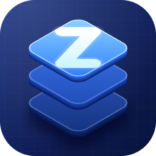

<p align="center"></p>

# Zonk-Core

**Run AI models on your phone. Share them through your own server.**

Zonk-Core is a free, open-source Android app with an iOS-style design. You download a model once, then chat with it
on your phone with no account and no cloud. The AI engine is [llama.cpp](https://github.com/ggml-org/llama.cpp),
built into the app.

[**Download the latest APK**](https://github.com/karolek13245/zonk-core/releases/latest) · [Terms](TERMS.md) · [License](LICENSE) · [Security](SECURITY.md) · [Report a problem](https://github.com/karolek13245/zonk-core/issues)

> **Status:** version 1.3.2 (build 2). Chatting on the phone works. Sharing a phone's model with other people is still in development.

---

## What it does

- **Chat on the phone.** Models run on the phone's own chip and answer offline once downloaded. Replies appear as they are written.
- **Pictures.** Send a photo and the AI explains what is in it. This needs the small Vision model (see below) and works on the phone only.
- **Message box.** A rounded box with a **+** button (add a picture), a **model button** to switch models in one tap, and a round send button that turns into **Stop** while the AI is writing.
- **Code boxes.** Code in a reply appears in a black box with a **Copy** button and a **Download** button.
- **Token total.** The chat shows how many tokens it uses so far, above the message box. You can switch it off in Settings.
- **Chat history.** Start a new chat, and archive or delete old ones. Chats are saved only on your phone.
- **Model catalog.** Download models inside the app over Wi-Fi, with a search box and category filters. Deleting a model asks first.
- **Settings.** A clean grouped list: run on the phone or not, the model catalog, the token switch, appearance, updates, your own server (optional), and About.
- **Cloud mode.** Point the app at any OpenAI-compatible server instead of using the phone's model. The API key is stored encrypted (Android Keystore) and never shown in error messages.
- **Backgrounds.** Pick a background in Settings → Appearance: Classic, Midnight, Ocean, Forest, Sunset or Violet. Every one has a light and a dark version and follows your phone's mode.
- **Seasonal effects.** Bats at Halloween (Oct 15 – Nov 1) and sparkles at Christmas (Dec 1 – Jan 6), drawn on top of the app. They never block taps, they stand still if you turned animations off on your phone, and you can switch them off (or preview them) in Settings → Appearance.
- **Update pop-up.** When the app opens it checks GitHub and, if a newer version is out, shows a pop-up with what changed. "Get update" opens the download page; the app never installs anything by itself. Turn the check off, or check by hand, in Settings → Updates.
- **Host tab.** Live battery, temperature, Wi-Fi and memory readings, a workload ring, and a model picker that only offers sizes your phone can run.
- **Clear AI notice.** Every chat shows "(model) is AI and can make mistakes."

## Models

The text models are 4-bit (Q4_K_M) GGUF files from Hugging Face. The Vision model is 8-bit and comes as two files (the model and its picture reader). They belong to their makers and have their own licenses.

| Model | Size | Good for | License | Memory needed (approx.) |
|---|---|---|---|---|
| Qwen2.5 1.5B Instruct | 0.99 GB | everyday chat, fastest | Apache 2.0 | 2.5 GB |
| SmolLM2 1.7B Instruct | 1.06 GB | everyday chat | Apache 2.0 | 2.6 GB |
| Llama 3.2 3B Instruct | 2.02 GB | better answers | Llama 3.2 Community License | 4 GB |
| Qwen2.5 Coder 3B Instruct | 2.01 GB | code | Apache 2.0 | 4 GB |
| Qwen2.5 7B Instruct | 4.68 GB | best answers, needs a strong phone | Apache 2.0 | 8 GB |
| SmolVLM 500M (reads pictures) | 0.55 GB (two files) | explaining pictures | Apache 2.0 | 2 GB |

Check each model's page on Hugging Face before using it commercially.

### Sending pictures

1. In **Settings → Models**, download **SmolVLM 500M (reads pictures)**.
2. In **Chat**, tap the model button under the message box and pick **SmolVLM 500M**.
3. Tap the **+** button, choose a photo, and ask about it (or just send it).

Pictures are shrunk and kept only on your phone, and are deleted with their chat. Pictures are not sent in Cloud mode.
Reading a picture takes a while on a phone, and a small model can get details wrong.

## Install

1. Open the [latest release](https://github.com/karolek13245/zonk-core/releases/latest) on your phone.
2. Download `app-debug.apk` and open it. Allow installing from your browser if Android asks.
3. Open Zonk-Core, follow the short walkthrough, and download a model from the Host tab or Settings.

**You need:** a 64-bit ARM Android phone (almost every phone since about 2018), Android 8.0 or newer, and free storage for the model.
The app downloads models over Wi-Fi only.

## How sharing will work (in development)

The goal is that your phone runs a model and answers requests from other people through a small relay server:

```
Other user's app  ──►  relay (Cloudflare Worker)  ──►  your phone  ──►  answer back
```

Phones connect out to the relay, so no router setup is needed. The relay lives in a separate repo, `zonk-relay`, and is
deployed but not yet connected to the app. The Start button on the Host tab is a placeholder for now.

## Privacy

- On-device chat is processed on your phone and not sent anywhere.
- Cloud mode sends your messages to the server address you set.
- Chat history is stored only on your phone.
- The update check asks GitHub for the newest release when the app opens (at most every 6 hours). GitHub can see your internet address; nothing from your chats is sent. You can turn it off in Settings → Updates.
- Full details are in the [Terms](TERMS.md). To report a security problem, see [SECURITY.md](SECURITY.md).

## Build it yourself

The easiest way is GitHub Actions: push this repo and the included workflow builds the APK
(Actions → latest run → download `app-debug-apk`). The repo root must contain `settings.gradle.kts` and `app/`.

**Signing.** So that every build installs over the one before it, the workflow signs the APK with your own key. Add two repository
secrets (Settings → Secrets and variables → Actions): `ZONK_KEYSTORE_BASE64` (a PKCS12 key file as one line of base64) and
`ZONK_KEYSTORE_PASSWORD`. Make the key once with
`keytool -genkeypair -storetype PKCS12 -keystore zonk.p12 -alias zonk -keyalg RSA -keysize 4096 -validity 10000`
(the alias must be `zonk`), then `base64 -w0 zonk.p12`. Keep a private backup of the key: if it is lost, nobody can update over
the old app any more. A fork without the secrets still builds, with a throwaway debug key.

To build locally with Android Studio:

```
git clone --depth 1 --branch b10667 https://github.com/ggml-org/llama.cpp app/src/main/cpp/llama.cpp
./gradlew assembleDebug
```

The C++ bridge targets llama.cpp release `b10667`. If you move to a newer release and it fails to compile, the function names may have changed.

## Project layout

```
app/src/main/java/com/example/aiapp/
  MainActivity.kt        tabs, sending and stopping replies, history logic
  ChatScreen.kt          the chat: message box, model button, bubbles
  ChatStore.kt           saves chats to a file
  ChatHistoryScreen.kt   the Chats screen
  HostScreen.kt          device readings and workload
  SettingsScreen.kt      Settings as grouped lists: models, chat, appearance, updates, server, About
  SettingsExtras.kt      the Appearance and Updates groups of Settings
  AboutScreen.kt         About group and Terms screen
  Theme.kt               light and dark colours, background drawing
  AppThemes.kt           the background themes (colours only)
  SeasonMath.kt          dates and movement of the bats and sparkles (no drawing, easy to test)
  SeasonOverlay.kt       draws the bats and sparkles
  UpdateCheck.kt         asks GitHub for new releases, compares versions, tidies the notes
  UpdateDialog.kt        the update pop-up
  SecureStore.kt         keeps the API key encrypted (Android Keystore)
  CodeBlocks.kt          black code boxes with Copy and Download
  ImageUtils.kt          shrinks and stores pictures
  Models.kt              model catalog and downloads
  LlamaBackend.kt        on-device engine (Kotlin side)
  Backend.kt             cloud server client
app/src/main/cpp/        llama.cpp bridge (C++)
app/src/main/res/mipmap-*/  the app icon layers (colour, background and themed)
design/icon/             the icon master (SVG) and pictures (512 px for avatars and stores)
```

## Known limits

- The API key is stored encrypted, with a lock kept in the Android Keystore. That protects it from other apps and from a copy of the app's files, but not from someone who has full control of your phone (for example a rooted phone or malware with that level of access). If the phone's Keystore doesn't work, the key is kept only until you close the app and Settings says so.
- The release APK is a debug build signed with Zonk-Core's own key (certificate SHA-256 `f5b4097bc8a3dbaf77e0de371ab0a189d3e07039beea0bf3d9b9690551902c32`; check it with `apksigner verify --print-certs app-debug.apk`). The app does not check a download for you, so get it only from this repo's [releases](https://github.com/karolek13245/zonk-core/releases) page. Older APKs used a different throwaway key each time: if Android says the app conflicts with an existing package, uninstall the old one once (this deletes its chats and models).
- Models answer from a 2048-token window (4096 for the Vision model), so very long chats drop their oldest messages.
- The Vision model looks at the newest picture in a chat only, and drops older messages before it.
- A reply stops after about 512 tokens (a few paragraphs).
- Sharing (the relay) is not connected yet.
- Before a Play Store release: change `applicationId` in `app/build.gradle.kts`, add a privacy policy, and turn on release shrinking.

## License

Zonk-Core's own code is released under the [MIT License](LICENSE). Third-party software and the AI models keep their own
licenses: see [THIRD_PARTY_NOTICES.md](THIRD_PARTY_NOTICES.md), the [model licensing policy](MODEL-LINCESES.md) and the
model table above.

## Contact

Questions and ideas: [open an issue](https://github.com/karolek13245/zonk-core/issues).
